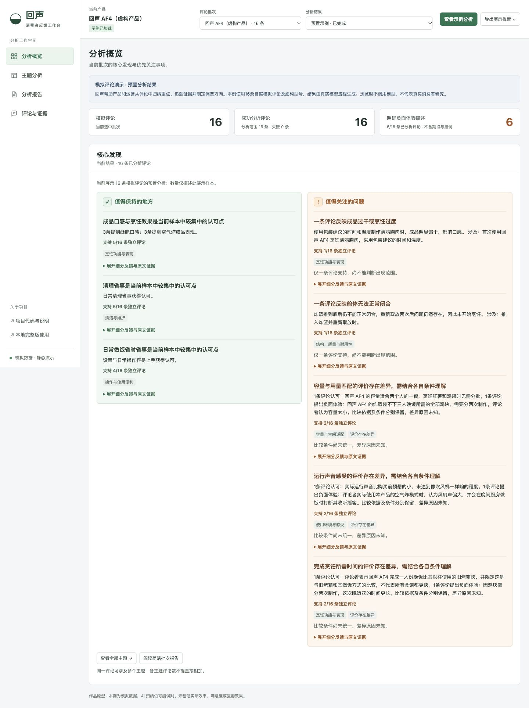

# 回声 · 消费者反馈分析工作台

面向产品和运营人员的个人作品原型：把一批零散评论整理成**值得保持的体验、值得关注的问题和有依据的下一步行动**，每项发现都能回看原文。

[打开公开演示](https://susie041720.github.io/echo-feedback-lab/) · [主题与不同评价](https://susie041720.github.io/echo-feedback-lab/#/themes) · [分析报告](https://susie041720.github.io/echo-feedback-lab/#/report)

> **公开版使用16条项目自编模拟评论，产品“回声 AF4”为虚构型号。** 预置结果由实际模型分析流程生成，访客浏览时不调用模型，无需 ChatGPT、账号或 API key。它不是消费者研究成果，也不是准确率测试集。真实 Ninja AF101 评论、模型输出和原文截图没有上传到此仓库。



## 能做什么

- 分析概览：集中展示核心发现，以绿色和橙色明确区分值得保持与值得关注。
- 主题分析：按产品体验分类筛选，查看数量、正负中立描述、不同条件与原文。
- 分析报告：结论、关键依据、对应行动；详细论证和证据按需展开，支持导出。
- 评论与证据：原始评论、细分反馈、使用情境；本地版支持可选修订。
- 本地批量分析：整批提交、适度并发、有限重试、暂停续跑与同版本结果复用。无需逐条人工确认。

## 分析流程与规则

导入 CSV → 模型逐条提取 → 校验字段及逐字引用 → 程序统一主题、按评论 ID 去重 → 选择核心发现 → 基于具体主题与证据提出行动方向 → 查看/导出。

一级分类集中维护为：烹饪功能与表现、操作与使用便利、容量与空间适配、清洁与维护、结构质量与耐用性、使用环境与感受、价格与价值感、其他明确反馈。分类、评价倾向、产品归属和经历类型分开判断，不按整条星级推断观点。

一条评论可同时有优点和槽点。中立用途与背景、用户期望、担心、转述、其他产品和信息不足分别保留；未知不强行变成中立或用户待审核任务。退货、推荐及复购意向另列，不充当体验分类。

同义主题可合并，部件或条件不同的问题保留。只有同一具体主题才提示评价差异，双方条件与比较对象仍可不同，不用正面数量抵消负面。数量表示独立评论条数，分母为实际成功分析数，跨主题不可相加。

模型负责逐条语义提取；主题归并、计数、核心筛选和建议规则由程序执行。结构和引用检查不保证语义完全正确，建议不冒充消费者直接需求或已经证实的原因。

## 我的工作

我负责需求设计、分类与评价规则定义、输出检查和多轮迭代，包括区分实际体验与期待、约束证据、检查归纳边界及调整业务界面。代码实现与调试使用 Codex 辅助。项目用于展示这些产品设计与验证过程，不包装为已投入生产的企业系统。

## 演示版与本地版

| | 公开演示 `docs/` | 本地完整版 `local_app/` |
|---|---|---|
| 数据 | 16条明确标注的模拟评论 | 上传自己有权使用的评论 |
| 模型 | 已生成的预置结果，访问时无调用 | 需要配置兼容接口和自己的 key |
| 操作 | 筛选、主题详情、证据、报告与导出 | 另支持上传、批量处理、续跑和可选修订 |
| 存储 | 同源静态资源，只读 | 原文、模型结果、修订及排错记录分开保存 |
| 质量检查 | 已完成的开发验证说明 | 可选质量检查与调试入口，不构成日常门槛 |

## 本地启动

要求 Python 3.9+，只使用标准库，无需安装 pip 或 Node 依赖。

```bash
git clone https://github.com/susie041720/echo-feedback-lab.git
cd echo-feedback-lab/local_app
python3 app.py
```

打开 `http://127.0.0.1:8772/`。若端口已占用，可运行 `python3 app.py --port 8780`。macOS 也可双击 `local_app/启动工作台.command`。

从“导入与产品设置”上传 UTF-8 CSV，必须含 `text` 列；空模板为 `local_app/data/upload_template.csv`。正文、标题、评分、日期、型号、商品标识、来源、购买验证及可获取标签原样保留，只做必要格式处理和完全重复去重。

在设置抽屉填写 HTTPS API Base、模型 ID、API 类型和自己的 key。支持兼容 Responses / Chat Completions 接口。`.env.example` 仅说明占位配置，不自动加载。key只驻留当前任务，不写入文件、浏览器存储或导出。提交分析会把正文、标题与必要商品标识发送给所配置的模型服务，请使用自己有权处理的数据。

默认并发2，可设1–4；单条最多自动重试1次，限流后降速。输入、模型与分析规则等版本一致时复用成功结果，批次处理结束后统一归纳。日常不要求逐条人工确认，失败和覆盖范围如实显示。

## 数据来源与验证

真实数据仅作本机研究验证：Amazon Reviews 2023 / McAuley Lab，精确 ASIN 对应 Ninja AF101。原50条与新增25条独立保存，新增样本按原始文件顺序选取此前未分析过的记录，无内容或评分筛选、与原50条重叠0；它不是随机或分层采样。此次联网重验遇到连接异常，新增记录使用此前保留的发布方原始扫描，逐条核对原字段和源行哈希。未扩大成全产品数据集。

发布方明确表示无法为评论文本授予许可证，主要为研究提供数据；未确认公开原文展示、再分发或商业使用许可。因此本仓库不含真实评论、对应模型输出、研究报告或原文截图。删除用户名本身不能解决文本权限问题。来源：[原始项目](https://amazon-reviews-2023.github.io/main.html)、[发布方许可说明](https://huggingface.co/datasets/McAuley-Lab/Amazon-Reviews-2023/discussions/1)，复核于2026-10-18。

公开模拟案例覆盖正面、负面、中立、期待、担心、同主题不同评价、其他产品、模糊表达、混合反馈和行为意向。它是专门设计的功能覆盖样本，与真实自然顺序采样的25条分开；不能以其比例推断真实市场。

具体运行记录与边界见 [验证记录](VALIDATION.md)。首次分析、定向修正与结果复用分别记录，不把复用速度当成首次推理性能，不外推大规模能力。

## 开发检查与重新构建

```bash
python3 -B -m unittest discover -s local_app -p 'test*.py' -q
python3 -B tools/build_demo.py
python3 -B tools/audit_release.py
python3 -m http.server 8080 --directory docs
```

`demo_source/generated_case.json` 只含模拟源数据与真实模型逐条输出的安全字段。`build_demo.py` 复用本地分类、统计、报告和界面生成 `docs/`；不会调用模型或读取真实研究库。两条遗漏的行为曾定向重新提取，原始开发结果保留在本地，没有把人工编写的分析伪装为模型输出。

本次验证补充了显式中文比较表达、运行噪音同义标识，以及偏干描述的聚合适配；原模型提取仍保留，未为这些展示规则重跑所有评论。相关配置集中在 `local_app/config/`，没有把示例结论硬编码成产品事实。

## GitHub Pages 部署

仓库 Settings → Pages → Deploy from a branch → `main` 分支、`/docs` 目录。入口为 `docs/index.html`，`.nojekyll` 保持纯静态资源；资源和报告路径相对于项目子目录。使用 `#/themes` 等哈希路由，直接打开和刷新无需后端重写。公开站点不提供上传、模型配置或实时分析入口。

## 当前限制

这是个人作品原型。模型仍可能遗漏观点、混淆中立与未知，或过度保守地遗漏实际现象。部分归并依赖可维护的主题与动作规则，需要继续抽样评估，不能把自动检查通过称为语义完全正确。

真实研究样本较小、非随机且偏向高评分；公开样本为有意设计的模拟案例。未做独立标注集准确率评测，也没有首次处理大规模批次的性能证据。尚未验证实际工作中的效率提升、满意度、复购率或改进效果；建议不是因果结论。
